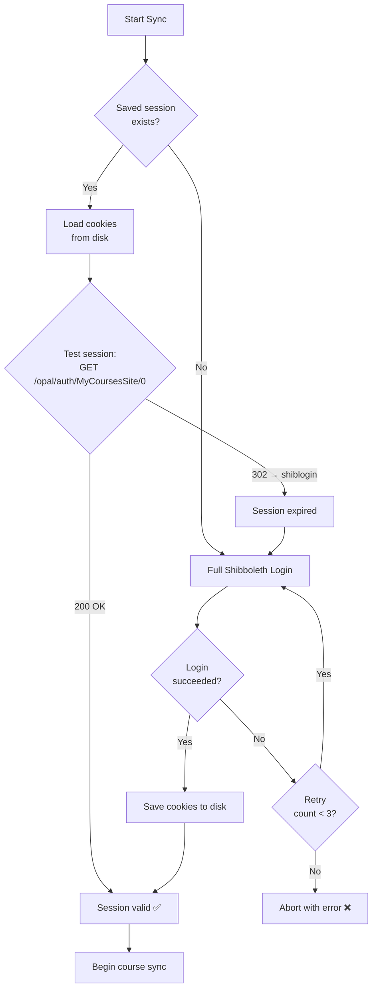

# OPAL Course Sync Client — Shibboleth-Based Development Plan

> [!IMPORTANT]
> **Revised plan.** WebDAV and REST API are disabled for students on OPAL BPS. This plan uses **Shibboleth SSO authentication + web scraping** exclusively.

---

## 1. Verified Shibboleth Login Flow

The following flow was **live-probed** against the real OPAL production server. Every URL, form field, and cookie is confirmed accurate.

```mermaid
sequenceDiagram
    participant Client as opal-sync
    participant OPAL as bildungsportal.sachsen.de
    participant SP as Shibboleth SP (/dfn/)
    participant IdP as shib1.rz.htwk-leipzig.de

    Note over Client: Step 1: Get session
    Client->>OPAL: GET /opal/shiblogin (follow redirects)
    OPAL-->>Client: 302 → /opal/shiblogin;jsessionid=...
    OPAL-->>Client: 200 OK + JSESSIONID cookie + WAYF form

    Note over Client: Step 2: Select HTWK Leipzig
    Client->>OPAL: POST /opal/shiblogin;jsessionid=...?0-1.-loginContainer-login-shibAuthForm<br/>Body: wayfselection=7&shibLogin=x
    OPAL-->>Client: 302 + idpsite-presel cookie
    Note right of OPAL: Location: /dfn/Shibboleth.sso/Login?<br/>target=...&entityID=https://shib1.rz.htwk-leipzig.de/idp/shibboleth

    Note over Client: Step 3: SP initiates SAML
    Client->>SP: GET /dfn/Shibboleth.sso/Login?target=...&entityID=...
    SP-->>Client: 302 + _opensaml_req cookie
    Note right of SP: Location: https://shib1.rz.htwk-leipzig.de/idp/profile/<br/>SAML2/Redirect/SSO?SAMLRequest=...&RelayState=...

    Note over Client: Step 4: IdP local storage check
    Client->>IdP: GET /idp/profile/SAML2/Redirect/SSO?SAMLRequest=...
    IdP-->>Client: 302 → ?execution=e1s1 + __Host-JSESSIONID cookie
    Client->>IdP: GET ?execution=e1s1 → 200 (LS check form)
    Client->>IdP: POST ?execution=e1s1<br/>Body: csrf_token=...&shib_idp_ls_supported=&_eventId_proceed=
    IdP-->>Client: 302 → ?execution=e1s2

    Note over Client: Step 5: Submit credentials
    Client->>IdP: GET ?execution=e1s2 → 200 (credential form)
    Note right of IdP: Fields: csrf_token, j_username, j_password
    Client->>IdP: POST ?execution=e1s2<br/>Body: csrf_token=...&j_username=sXXXXX&j_password=...&_eventId_proceed=
    IdP-->>Client: 200 HTML with hidden SAML form<br/>(SAMLResponse + RelayState as hidden inputs, auto-submit JS)

    Note over Client: Step 6: Complete SSO
    Client->>SP: POST /dfn/Shibboleth.sso/SAML2/POST<br/>Body: SAMLResponse=...&RelayState=...
    SP-->>Client: 302 → /opal/shibboleth?ajax=true + _shibsession cookie
    Client->>OPAL: GET /opal/shibboleth?ajax=true
    OPAL-->>Client: 302 → /opal/auth/... (authenticated dashboard)
    Note over Client: ✅ Authenticated! JSESSIONID + _shibsession valid
```

### Key Form Fields Reference

| Step | URL | Method | Fields |
|------|-----|--------|--------|
| 2 | `/opal/shiblogin;jsessionid=...?0-1.-loginContainer-login-shibAuthForm` | POST | `wayfselection=7`, `shibLogin=x` |
| 4 | `/idp/profile/SAML2/Redirect/SSO?execution=e1s1` | POST | `csrf_token`, `shib_idp_ls_supported=`, `shib_idp_ls_success.shib_idp_session_ss=false`, `shib_idp_ls_success.shib_idp_persistent_ss=false`, `_eventId_proceed=` |
| 5 | `/idp/profile/SAML2/Redirect/SSO?execution=e1s2` | POST | `csrf_token`, `j_username`, `j_password`, `_eventId_proceed=` |
| 6 | `/dfn/Shibboleth.sso/SAML2/POST` | POST | `SAMLResponse`, `RelayState` |

### Critical Cookies

| Cookie | Domain | Purpose |
|--------|--------|---------|
| `JSESSIONID` | `bildungsportal.sachsen.de` | OPAL application session |
| `idpsite-presel` | `bildungsportal.sachsen.de` | Remembers institution selection |
| `_opensaml_req_*` | `bildungsportal.sachsen.de` | SAML request tracking |
| `__Host-JSESSIONID` | `shib1.rz.htwk-leipzig.de` | IdP session |
| `_shibsession_*` | `bildungsportal.sachsen.de` | Shibboleth session post-auth |

---

## 2. OPAL Internal URL Patterns (Post-Authentication)

Once authenticated, OPAL uses OpenOLAT's standard URL routing:

```
Base: https://bildungsportal.sachsen.de/opal

/auth/MyCoursesSite/0              → "Meine Kurse" (enrolled courses list)
/auth/RepositoryEntry/{courseId}    → Navigate to specific course
/auth/RepositoryEntry/{courseId}/CourseNode/{nodeId}  → Specific course element (folder, document, etc.)
```

### Course Content Structure
OPAL courses are composed of **course elements** (nodes). Relevant node types:
- **Folder** (`bc`) — File storage area with downloadable documents
- **Single Page** (`sp`) — Embedded HTML page (may contain links)
- **File Dialog** (`dialog`) — Discussion-attached file uploads
- **Task** (`ita`/`ta`) — Assignment with uploaded materials
- **Wiki** / **Blog** — Content pages

### File Download Patterns
Files are served via internal dispatcher URLs. The exact pattern depends on how the course is structured, but typically involves:
- Links within course folder listings (`<a href="...">` pointing to file resources)
- URLs often contain paths like `/opal/auth/RepositoryEntry/{id}/CourseNode/{nodeId}/path/{filename}` or similar dynamic routing through the Wicket/AJAX framework

> [!WARNING]
> OPAL uses **Apache Wicket** as its web framework. Most UI interactions are AJAX-based with dynamic URLs containing session-specific components (like `?0-1.0-panel-...`). **Static URL scraping is insufficient** — the tool needs to either parse Wicket AJAX responses or use a real browser engine.

---

## 3. Implementation Strategy Decision

### Option A: `httpx` Session-Based (Recommended for MVP)

```
Pros:
  ✅ Lightweight, fast, low resource usage
  ✅ No browser needed, works headless on servers
  ✅ Full control over HTTP requests
  ✅ Shibboleth login flow is pure HTTP (no JS needed)
  
Cons:
  ⚠️ Must parse Wicket AJAX HTML responses
  ⚠️ Fragile if OPAL changes HTML structure
  ⚠️ Need to manually follow Wicket component URLs
```

### Option B: Playwright Browser Automation

```
Pros:
  ✅ Handles JavaScript rendering (Wicket AJAX)
  ✅ Can use page.click() / page.locator() for navigation
  ✅ More resilient to minor UI changes
  ✅ Can screenshot for debugging
  
Cons:
  ⚠️ Heavy (downloads Chromium ~150MB)
  ⚠️ Slower (full browser rendering)
  ⚠️ More complex error handling
```

### Recommendation: **Hybrid Approach**

| Phase | Strategy |
|-------|----------|
| **Authentication** | `httpx` — The Shibboleth flow is pure HTTP, no JS needed |
| **Course Discovery** | `httpx` + `BeautifulSoup` — Parse `/auth/MyCoursesSite/0` HTML |
| **Content Navigation** | `httpx` + HTML parsing — Follow Wicket-rendered course tree |
| **File Download** | `httpx` — Direct GET on file URLs with session cookies |
| **Fallback** | `playwright` — Only if Wicket AJAX proves impossible to parse |

---

## 4. Architecture

### Technology Stack

| Component | Choice | Rationale |
|---|---|---|
| **Language** | Python 3.11+ | Best ecosystem for HTTP/scraping |
| **HTTP Client** | `httpx` (async) | Modern, async-native, session support |
| **HTML Parser** | `beautifulsoup4` + `lxml` | Robust HTML parsing |
| **Browser (fallback)** | `playwright` | Headless Chromium for JS-heavy pages |
| **CLI** | `typer` + `rich` | Modern CLI with progress bars |
| **Config** | TOML (`tomllib`) | Python-native, human-readable |
| **DB** | SQLite via `sqlite3` | Sync state tracking |
| **Credentials** | `keyring` | OS credential store (Win Credential Manager) |

### Project Structure

```
opal-sync/
├── pyproject.toml
├── README.md
├── src/
│   └── opal_sync/
│       ├── __init__.py
│       ├── __main__.py              # Entry: python -m opal_sync
│       ├── cli.py                   # Typer CLI commands
│       ├── config.py                # TOML config loader
│       │
│       ├── auth/
│       │   ├── __init__.py
│       │   ├── shibboleth.py        # Full Shibboleth SAML login flow
│       │   ├── session.py           # Session manager (cookie persistence, refresh)
│       │   └── credentials.py       # Keyring-based credential storage
│       │
│       ├── scraper/
│       │   ├── __init__.py
│       │   ├── courses.py           # Parse "Meine Kurse" → list of courses
│       │   ├── course_tree.py       # Navigate course node tree
│       │   ├── folder.py            # Parse folder nodes → file listings
│       │   ├── file_links.py        # Extract download URLs from HTML
│       │   └── wicket.py            # Wicket AJAX response parser helper
│       │
│       ├── sync/
│       │   ├── __init__.py
│       │   ├── engine.py            # Core sync orchestration
│       │   ├── downloader.py        # Async file downloader with retries
│       │   ├── differ.py            # Change detection (size, date, ETag)
│       │   └── conflict.py          # Filename conflict resolution
│       │
│       ├── models/
│       │   ├── __init__.py
│       │   ├── course.py            # Course dataclass
│       │   ├── node.py              # Course element/node dataclass
│       │   └── file_entry.py        # Downloaded file metadata
│       │
│       ├── storage/
│       │   ├── __init__.py
│       │   └── db.py                # SQLite sync state database
│       │
│       └── utils/
│           ├── __init__.py
│           ├── logging.py           # Structured logging with rich
│           └── sanitize.py          # Filename/path sanitization (Windows-safe)
│
├── tests/
│   ├── conftest.py
│   ├── test_shibboleth.py           # Mock Shibboleth flow tests
│   ├── test_scraper.py
│   ├── test_sync.py
│   └── fixtures/                    # Saved HTML responses for testing
│       ├── shiblogin.html
│       ├── idp_login.html
│       ├── my_courses.html
│       └── course_folder.html
│
└── config.example.toml
```

---

## 5. Implementation Phases

### Phase 1: Authentication & First Download — ~1 week

**Goal:** Log in via Shibboleth, list courses, download first file.

```python
# Pseudocode for the Shibboleth flow
async def shibboleth_login(client: httpx.AsyncClient, username: str, password: str) -> bool:
    # Step 1: Get OPAL login page (follow redirects for JSESSIONID)
    resp = await client.get("https://bildungsportal.sachsen.de/opal/shiblogin")
    jsessionid = extract_jsessionid(resp)
    form_action = extract_form_action(resp.text)  # shibAuthForm URL

    # Step 2: POST WAYF selection (HTWK Leipzig = value 7)
    resp = await client.post(form_action, data={"wayfselection": "7", "shibLogin": "x"})
    sso_url = resp.headers["Location"]  # → /dfn/Shibboleth.sso/Login?...

    # Step 3: Follow SP redirect → IdP SAML redirect
    resp = await client.get(sso_url)  # 302 → IdP with SAMLRequest
    idp_url = resp.headers["Location"]

    # Step 4: IdP local storage check form
    resp = await client.get(idp_url)  # 302 → ?execution=e1s1
    resp = await client.get(resp.headers["Location"])  # GET form
    csrf_token = extract_csrf_token(resp.text)
    resp = await client.post(resp.url, data={
        "csrf_token": csrf_token,
        "shib_idp_ls_success.shib_idp_session_ss": "false",
        "shib_idp_ls_success.shib_idp_persistent_ss": "false",
        "shib_idp_ls_supported": "",
        "_eventId_proceed": "",
    })  # 302 → ?execution=e1s2

    # Step 5: Submit credentials
    resp = await client.get(resp.headers["Location"])
    csrf_token = extract_csrf_token(resp.text)
    resp = await client.post(resp.url, data={
        "csrf_token": csrf_token,
        "j_username": username,
        "j_password": password,
        "_eventId_proceed": "",
    })
    # Response: HTML page with hidden form containing SAMLResponse + RelayState
    saml_response, relay_state, post_url = extract_saml_form(resp.text)

    # Step 6: POST SAML assertion back to SP
    resp = await client.post(post_url, data={
        "SAMLResponse": saml_response,
        "RelayState": relay_state,
    })
    # Follow final redirects → authenticated OPAL session
    # ...
    return resp.status_code == 200
```

#### Tasks:
- [ ] Set up project skeleton with `pyproject.toml`, virtual env
- [ ] Implement `shibboleth.py` with the full 6-step login flow
- [ ] Implement `session.py` for cookie persistence (save/load cookies to disk)
- [ ] Implement `credentials.py` with `keyring` storage
- [ ] Implement `courses.py` — fetch & parse `/auth/MyCoursesSite/0`
- [ ] Create CLI: `opal-sync login` (test auth), `opal-sync courses` (list courses)
- [ ] Save test HTML fixtures for offline development
- [ ] Write tests against saved fixtures

### Phase 2: Course Tree Scraping & File Download — ~1-2 weeks

**Goal:** Navigate course folder structure, discover and download all files.

#### Tasks:
- [ ] Implement `course_tree.py` — enter a course, parse the navigation tree
- [ ] Implement `folder.py` — find folder nodes, list files within them
- [ ] Implement `file_links.py` — extract actual download URLs from folder HTML
- [ ] Implement `wicket.py` — Wicket AJAX response parsing utilities
- [ ] Implement `downloader.py` — async file download with:
  - Progress bars (per-file and total)
  - Retry with exponential backoff
  - Content-Disposition header parsing for filenames
  - Size verification
- [ ] Implement `sanitize.py` — Windows-safe filename sanitization
- [ ] Create local directory structure: `~/OPAL/{Semester}/{CourseName}/...`
- [ ] CLI: `opal-sync sync` — full sync command
- [ ] CLI: `opal-sync sync --dry-run` — show what would be downloaded

### Phase 3: Incremental Sync & State Management — ~1 week

**Goal:** Only download new/changed files, track sync history.

#### Tasks:
- [ ] Implement `db.py` — SQLite database with schema (see Section 7)
- [ ] Implement `differ.py` — change detection:
  - Compare `Content-Length` header vs stored size
  - Compare `Last-Modified` header vs stored timestamp
  - Compare `ETag` if available
  - Handle missing headers gracefully
- [ ] Track per-file download state in DB
- [ ] Implement sync log for audit trail
- [ ] Course include/exclude filtering from config
- [ ] File extension filtering from config
- [ ] Handle deleted remote files (config: keep or remove local)
- [ ] Session refresh — detect expired session, re-authenticate automatically
- [ ] CLI: `opal-sync status` — show sync statistics
- [ ] CLI: `opal-sync log` — show recent sync activity

### Phase 4: Polish & Reliability — ~1 week

- [ ] **Desktop notifications** — Toast notification on new files (via `plyer`)
- [ ] **Parallel downloads** — Async concurrent downloads (configurable, default 3)
- [ ] **Bandwidth limiting** — Configurable max download speed
- [ ] **Error reporting** — Detailed error logs with context
- [ ] **Semester detection** — Auto-detect current semester from course names
- [ ] **README / documentation** — Setup guide with screenshots
- [ ] **Playwright fallback** — For courses where HTML parsing fails
- [ ] **Packaging** — `pip install opal-sync` or standalone `.exe` via `pyinstaller`

---

## 6. Configuration

```toml
# ~/.opal-sync/config.toml

[general]
sync_directory = "~/Documents/OPAL"
log_level = "INFO"                           # DEBUG | INFO | WARNING | ERROR
log_file = "~/.opal-sync/opal-sync.log"

[auth]
university = "htwk-leipzig"                  # Maps to WAYF value 7
username = "s12345"                          # HTWK login (Matrikelnummer)
# Password is stored in Windows Credential Manager via keyring
# Set with: opal-sync login

[auth.session]
cookie_file = "~/.opal-sync/session.json"    # Persisted session cookies
session_ttl_hours = 8                        # Re-auth after this many hours
max_retry_auth = 3                           # Retry login on failure

[sync]
include_extensions = []                      # Empty means no include whitelist
exclude_extensions = []                      # Include matches override exclusions
max_file_size_mb = 500
parallel_downloads = 3
request_delay_seconds = 1.0                  # Delay between requests (be polite)
delete_removed = false                       # Keep local files if removed on OPAL

[courses]
# If both lists are empty, all enrolled courses are synced.
# Matching is case-insensitive substring matching; exclude matches always block.
include = []
exclude = []

# Optional exact course-name overrides; relative paths are under sync_directory.
[courses.paths]
# "N021 Mathematik 1 - EIB, STB" = "Mathematik 1"

[notifications]
enabled = true
on_new_files = true                          # Notify when new files downloaded
on_errors = true                             # Notify on sync failures
```

### University Mapping

```toml
# Built-in mapping (no config needed)
[universities]
"berufsakademie-sachsen"  = 0
"duale-hochschule"        = 1
"hfm-dresden"             = 2
"hochschuldidaktik"       = 3
"hs-mittweida"            = 4
"hs-zittau-goerlitz"      = 5
"htw-dresden"             = 6
"htwk-leipzig"            = 7   # ← Default for this project
"slub-dresden"            = 8
"svwa"                    = 9
"smwkt"                   = 10
"tu-freiberg"             = 11
"tu-chemnitz"             = 12
"tu-dresden"              = 13
"uni-leipzig"             = 14
"whz-zwickau"             = 15
"palucca-dresden"         = 16
"bps-vho"                 = 17
```

---

## 7. Database Schema

```sql
-- Sync state database (~/.opal-sync/state.db)

CREATE TABLE IF NOT EXISTS courses (
    id              INTEGER PRIMARY KEY AUTOINCREMENT,
    opal_id         TEXT NOT NULL UNIQUE,           -- RepositoryEntry ID from URL
    name            TEXT NOT NULL,                   -- Display name
    url             TEXT NOT NULL,                   -- Full OPAL URL
    semester        TEXT,                             -- Detected semester (e.g. "WS2026/27")
    last_synced_at  DATETIME,
    is_excluded     BOOLEAN DEFAULT 0,
    discovered_at   DATETIME DEFAULT CURRENT_TIMESTAMP
);

CREATE TABLE IF NOT EXISTS course_nodes (
    id              INTEGER PRIMARY KEY AUTOINCREMENT,
    course_id       INTEGER NOT NULL REFERENCES courses(id) ON DELETE CASCADE,
    node_id         TEXT,                            -- CourseNode ID from URL
    node_type       TEXT,                            -- 'folder', 'singlepage', 'task', etc.
    title           TEXT,
    parent_node_id  INTEGER REFERENCES course_nodes(id),
    url             TEXT,
    UNIQUE(course_id, node_id)
);

CREATE TABLE IF NOT EXISTS files (
    id              INTEGER PRIMARY KEY AUTOINCREMENT,
    course_id       INTEGER NOT NULL REFERENCES courses(id) ON DELETE CASCADE,
    node_id         INTEGER REFERENCES course_nodes(id),
    remote_url      TEXT NOT NULL,                   -- Download URL
    remote_path     TEXT,                            -- Logical path in course
    local_path      TEXT NOT NULL,                   -- Absolute local filesystem path
    filename        TEXT NOT NULL,
    extension       TEXT,
    size_bytes      INTEGER,
    content_type    TEXT,                             -- MIME type from Content-Type header
    etag            TEXT,
    last_modified   TEXT,                             -- HTTP Last-Modified header value
    downloaded_at   DATETIME NOT NULL,
    checksum_sha256 TEXT,
    UNIQUE(course_id, remote_url)
);

CREATE TABLE IF NOT EXISTS sync_runs (
    id              INTEGER PRIMARY KEY AUTOINCREMENT,
    started_at      DATETIME NOT NULL,
    finished_at     DATETIME,
    status          TEXT NOT NULL DEFAULT 'running',  -- 'running', 'success', 'partial', 'failed'
    files_new       INTEGER DEFAULT 0,
    files_updated   INTEGER DEFAULT 0,
    files_skipped   INTEGER DEFAULT 0,
    files_failed    INTEGER DEFAULT 0,
    bytes_downloaded INTEGER DEFAULT 0,
    error_message   TEXT
);

CREATE TABLE IF NOT EXISTS sync_log (
    id              INTEGER PRIMARY KEY AUTOINCREMENT,
    run_id          INTEGER REFERENCES sync_runs(id),
    timestamp       DATETIME DEFAULT CURRENT_TIMESTAMP,
    level           TEXT NOT NULL,                    -- 'info', 'warning', 'error'
    action          TEXT NOT NULL,                    -- 'download', 'update', 'skip', 'error'
    course_name     TEXT,
    file_path       TEXT,
    details         TEXT
);
```

---

## 8. Session Management Strategy



> [!TIP]
> **Session persistence is critical.** Shibboleth sessions typically last several hours. By saving and reusing cookies, the tool avoids re-authenticating on every sync run — reducing load on the IdP and avoiding rate limiting.

---

## 9. Scraping Strategy for Course Content

### Step 1: List Enrolled Courses

```
GET /opal/auth/MyCoursesSite/0
→ Parse HTML for course links matching /auth/RepositoryEntry/{id}
→ Extract course name from link text or surrounding markup
```

### Step 2: Enter Course & Find Folder Nodes

```
GET /opal/auth/RepositoryEntry/{courseId}
→ Parse left-side navigation tree for course elements
→ Identify folder nodes (typically have folder icon CSS class)
→ Extract node URLs: /auth/RepositoryEntry/{courseId}/CourseNode/{nodeId}
```

### Step 3: List Files in Folder

```
GET /opal/auth/RepositoryEntry/{courseId}/CourseNode/{nodeId}
→ Parse file listing table/grid
→ Extract: filename, size, date, download link
→ Download links may be relative or absolute
```

### Step 4: Download Files

```
GET {download_url} (with session cookies)
→ Check Content-Disposition header for filename
→ Check Content-Length for size
→ Stream to disk with progress tracking
```

> [!NOTE]
> **Wicket AJAX complication:** Some folder listings may load via AJAX (Wicket `?0-1.0-panel-...` URLs). The scraper should:
> 1. First try standard page loads
> 2. If folder content is empty in HTML, look for Wicket AJAX initialization URLs in `<script>` tags
> 3. Replay those AJAX requests with proper `Wicket-Ajax-BaseUrl` and `Wicket-FocusedElementId` headers

---

## 10. Error Handling & Resilience

| Scenario | Handling |
|----------|----------|
| IdP unreachable | Retry 3x with 30s backoff, then abort |
| Wrong credentials | Prompt for re-entry, don't save invalid creds |
| Session expires mid-sync | Detect 302→shiblogin, re-auth, resume |
| File download fails | Retry 3x per file, log failure, continue with others |
| Wicket URL changed | Log warning, skip node, continue |
| Rate limit (429) | Respect `Retry-After`, exponential backoff |
| Network timeout | 30s connect timeout, 120s read timeout, retry |
| Disk full | Detect `OSError`, abort gracefully |
| Duplicate filenames | Append `_1`, `_2` suffix, track in DB |

---

## 11. CLI Interface

```bash
# First-time setup
opal-sync login                    # Interactive: enter HTWK credentials, test login
opal-sync config                   # Open/create config file in editor

# Core operations
opal-sync sync                     # Full sync (incremental if DB exists)
opal-sync sync --dry-run           # Show what would be downloaded
opal-sync sync --force             # Re-download all files
opal-sync sync --course "Mathe"    # Sync only matching courses

# Information
opal-sync courses                  # List enrolled courses
opal-sync status                   # Show sync statistics
opal-sync log                      # Show recent sync activity
opal-sync log --errors             # Show only errors

```

---

## 12. Risk Assessment

| Risk | Impact | Likelihood | Mitigation |
|------|--------|------------|------------|
| OPAL UI changes break scraping | High | Medium | Save HTML fixtures, version-detect UI, maintain CSS selector registry |
| IdP adds MFA/CAPTCHA | Critical | Low | Playwright fallback with manual initial auth + session reuse |
| BPS blocks automated access | High | Low | Conservative rate limiting (1 req/sec), realistic User-Agent |
| Wicket AJAX responses unparseable | Medium | Medium | Playwright fallback for specific problem pages |
| Session TTL too short | Medium | Low | Auto-detect expiry, re-auth seamlessly |

---

## 13. Getting Started

```bash
# 1. Create project
mkdir opal-sync && cd opal-sync
python -m venv .venv && .venv\Scripts\activate

# 2. Install dependencies
pip install httpx beautifulsoup4 lxml typer rich keyring

# 3. Start with auth module
# Implement shibboleth.py following the flow in Section 1
# Test: can you reach /opal/auth/MyCoursesSite/0 with a 200?

# 4. Save a test fixture
# After successful login, save the MyCoursesSite HTML response
# Use it for offline scraper development
```

> [!CAUTION]
> **Rate limiting:** Always include a configurable delay between requests (default 1 second). OPAL serves all Saxon universities — don't hammer the server. Use `request_delay_seconds` in config.
